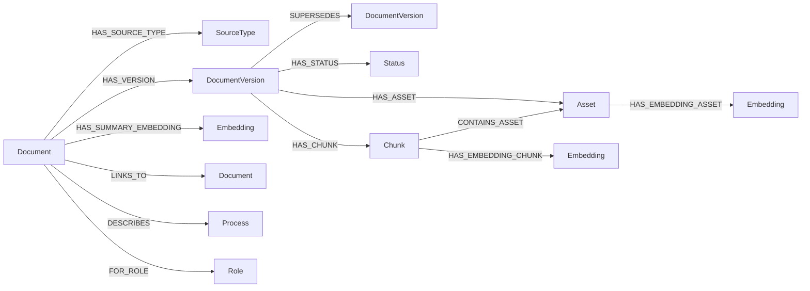

# MVP v2 — canonical multimodal Graph RAG schema

Status: **implemented owner-approved contract**. This document is the canonical
graph and storage contract for `mvp_v2`. The project is self-contained and does
not import legacy repository prototypes or their data artifacts.

## Product scope

The product is a local multimodal Graph RAG system with Streamlit, FastAPI, and
Telegram entry points. Its core workflows are:

- upload a URL, PDF, Markdown, HTML, or an image collection;
- preview extracted metadata before committing it;
- manage documents, versions, roles, processes, statuses, and document links;
- build only missing embeddings or rebuild all embeddings;
- explicitly build a LadybugDB from a selected numbered dump;
- select a ready LadybugDB for vector search and Chatbot;
- return text and image-description evidence with document citations.

This is a deliberately small multimodal Graph RAG. The contracts in this document
and the baseline OpenSpec capabilities define current behavior.

## Storage boundaries

- A staging area is the editable CSV representation being prepared for validation.
- A numbered **dump** is an immutable validated CSV snapshot used to build a DB.
- LadybugDB is the final query store derived from a selected validated dump.
- Uploaded images are ordinary files under the server media root.
- For images, LadybugDB stores only metadata, generated descriptions, and vectors;
  it also stores the graph nodes and relations defined below.
- LadybugDB never stores image BLOBs, Base64 payloads, or binary columns.
- Building/updating a DB is explicit. Uploading one document does not immediately
  rebuild the active DB.

A successful dump publication receives a sequential number and UTC timestamp:

```text
runtime/
  dumps/
    dump-000001/
      manifest.json
      tables/
    dump-000002/
      manifest.json
      tables/
  media/
  databases/
    main.lbdb
    experiment.lbdb
```

The UTC publication timestamp is stored in `manifest.json`; dump directory names use
only the sequential number.

Manifest contracts are versioned independently from graph properties. The graph
current schema version is `mvp-v2-graph-v2`, dump manifests use
`mvp-v2-dump-v1`, and database manifests use `mvp-v2-db-v1`. A current dump
manifest lists exactly the 22 graph CSV tables and includes the active schema-profile
SHA-256. Only `mvp-v2-graph-v2` is accepted; graph-v1 and 21-table artifacts are unsupported. Its `run_id` hashes the immutable dump identity and file facts. A database manifest records the source dump `run_id`; its `build_id` hashes all immutable database identity and row-count facts in canonical table-name order.

The first publication from a valid current session snapshot becomes `dump-000001`. A failed validation does not consume or publish a dump number.

## Graph



Relation direction is part of the contract. A new version supersedes an older one:

```text
new DocumentVersion -[:SUPERSEDES]-> old DocumentVersion
```

Version 1 has no `SUPERSEDES` edge. Each later version has exactly one `SUPERSEDES`
edge to the immediately preceding version of the same Document.

## Node properties

Typed core properties are defined below. Additional optional scalar properties can
be declared in `src/mvp_v2/graph_fields.json`; see `docs/graph-fields.md`.

### SourceType

```text
id STRING PRIMARY KEY
code STRING
```

Examples: `local_file`, `external_web`, `telegram`.

### Document

```text
id STRING PRIMARY KEY
title STRING
source_name STRING
content_format STRING
source_url STRING
external_id STRING
is_active BOOLEAN
summary STRING
```

`Document` does not duplicate a scalar `source_type`. The canonical classification
is the `HAS_SOURCE_TYPE` relation. Each document has exactly one SourceType.

An upload containing only images is represented as a normal Document with
`content_format = "image_collection"`. Its current version may have Assets and no
Chunks.

### DocumentVersion

```text
id STRING PRIMARY KEY
version INT64
sha256 STRING
local_path STRING
created_at TIMESTAMP
is_current BOOLEAN
error STRING
```

A changed document creates a new version. Old versions remain in the dump. Every
Document has at most one current version; every active Document has exactly one.

### Chunk

```text
id STRING PRIMARY KEY
position INT64
content STRING
content_hash STRING
summary STRING
```

Chunking is deterministic and intentionally simple. A Chunk belongs to exactly one
DocumentVersion.

### Asset

```text
id STRING PRIMARY KEY
asset_type STRING
mime_type STRING
source_url STRING
local_path STRING
external_id STRING
sha256 STRING
position INT64
description STRING
ocr_text STRING
```

For the first release, the indexed Asset type is `image`. `local_path` is a safe
relative path under the configured server media root, not arbitrary filesystem
access. The file itself is not stored in LadybugDB.

The image pipeline is:

```text
image file -> vision description -> text embedding -> Embedding
```

This is multimodal ingestion with text-aligned retrieval. It is not a direct
pixel/CLIP embedding. Equal image hashes may reuse computed work, but there is no
`ImageBlob` node.

### Embedding

```text
id STRING PRIMARY KEY
provider STRING
model STRING
model_version STRING
dimension INT64
vector FLOAT[N]
created_at TIMESTAMP
is_current BOOLEAN
summary_vector FLOAT[N]
```

Subject ownership and vector meaning are inferred from exactly one typed relation:
`HAS_EMBEDDING_CHUNK`, `HAS_EMBEDDING_ASSET`, or `HAS_SUMMARY_EMBEDDING`.
`summary_vector` is populated only for Chunk embeddings; it is empty for Asset and
Document embeddings. Summary vectors are stored but are not queried by the current
search workflow.

### Role

```text
id STRING PRIMARY KEY
name STRING
```

Examples: `student`, `support`. `support` is a Role, not a Process. A document may be
for multiple roles.

### Process

```text
id STRING PRIMARY KEY
name STRING
status STRING
owner STRING
```

A Process is a subject-domain process, for example `onboarding`. Documents describe
processes through `DESCRIBES`. Technical ingestion and embedding operations are not
Process nodes.

### Status

```text
id STRING PRIMARY KEY
name STRING
description STRING
```

Status describes DocumentVersion processing state. Initial values may include
`pending`, `processed`, `embedding_pending`, `ready`, and `error`.

## Required graph invariants

A dump must fail validation unless all applicable rules hold:

1. Every Document has exactly one `HAS_SOURCE_TYPE` relation.
2. Every DocumentVersion belongs to exactly one Document.
3. Every Document has at most one current DocumentVersion; every active Document has
   exactly one current DocumentVersion.
4. Every DocumentVersion has exactly one `HAS_STATUS` relation.
5. Every Chunk belongs to exactly one DocumentVersion.
6. Every Asset belongs to exactly one DocumentVersion.
7. Every Embedding is owned by exactly one Chunk, Asset, or Document, never more than one kind.
8. Only Chunk-owned Embeddings may contain a non-empty `summary_vector`.
9. A Chunk, Asset, or Document has at most one current
   Embedding matching the target LadybugDB identity: provider, model, model_version,
   and dimension.
10. Every relation endpoint exists and duplicate typed edges are rejected.
11. `CONTAINS_ASSET` is optional and both nodes must belong to the same version.
12. Image files resolve only under the configured media root and must match SHA-256.

## Vector-index contract

Versioning preserves embedding history in dumps, but it does not partition an ANN
index. `FLOAT[N]` has a fixed dimension, and vectors from different models are not
semantically comparable even when their dimensions match.

Therefore one LadybugDB contains one active embedding space:

```text
provider + model + model_version + dimension
```

The DB manifest records that identity, the vision model used for image descriptions,
the source dump number/date, and row counts. Only current Embeddings matching the
selected identity are loaded into LadybugDB and its ANN projection. Historical
DocumentVersions may be loaded as graph history. Historical Embeddings remain in the
selected cumulative dump but are not loaded into the query DB.

Chunks and Asset descriptions share the current ANN index because the same final text
embedding model produces both vectors. The incoming typed relation identifies the
result modality. Document-summary and Chunk-summary vectors are stored for a later
search phase and are not queried yet.

Changing model or dimension requires a full rebuild into another LadybugDB (or an
explicit safe replacement of the selected DB). Existing DB files remain selectable
until deliberately removed.

## Streamlit workflow

### Upload

1. Select URL/files or upload multiple images as an image collection.
2. Preview title, SourceType, Process, Role, detected content, images, and errors.
3. Commit only after explicit confirmation.
4. A changed existing document creates a new DocumentVersion.

### Dumps and processing

1. Commit changes to a staging area derived from the latest dump.
2. Build deterministic Chunks.
3. Generate missing image descriptions.
4. Choose **Build missing embeddings** or **Rebuild all embeddings**.
5. Validate the staged snapshot; only on success publish it as the next numbered,
   UTC-timestamped dump.

### LadybugDB

1. Select a dump and embedding configuration.
2. Build into a temporary DB path.
3. Load nodes/relations, create ANN index, verify counts, reopen, and smoke-query.
4. Publish only after success; a failed build leaves the existing DB untouched.
5. Creating a separate permanent DB happens only through an explicit **Save as new
   DB** action.

### Chatbot

1. Select one ready LadybugDB.
2. Embed the question with the exact text embedding model recorded by that DB.
3. Search current Chunk and Asset-description embeddings.
4. Traverse to DocumentVersion, Document, SourceType, Process, Role, and linked
   Documents.
5. Build bounded context and return an answer with text/image citations.
6. Refuse vector search when the configured question-embedding provider, model,
   model_version, or dimension does not exactly match the selected DB manifest.

## Deletion contract

Deletion is a graph operation first; source and media files are never deleted
automatically.

### Delete one DocumentVersion

1. Remove the selected DocumentVersion from a staging snapshot.
2. Cascade removal to its Chunks, Assets, Embeddings, and typed relations.
3. If it was current, promote the newest remaining version to current.
4. If no version remains, set the owning Document to inactive.
5. Rebuild `SUPERSEDES` so each remaining version points only to its immediate
   predecessor.

### Delete a whole Document

Remove the Document, every version, Chunk, Asset, Embedding, and all incoming and
outgoing typed relations from the new dump and query DB.

### Delete an Asset or Embedding

- Deleting one Asset also removes its Asset Embeddings and `CONTAINS_ASSET` edges.
- Deleting an Embedding removes only that vector and ownership edge. Its Chunk or
  Asset remains and is shown as missing an embedding until rebuilt.

### Publication and visibility

Before confirmation, Streamlit shows the exact versions, Chunks, Assets, Embeddings,
relations, and server files affected. A confirmed deletion creates and validates the
next dump, then immediately rebuilds and activates the selected LadybugDB. The
operation is reported as complete only after the replacement DB passes count and ANN
checks. Before the replacement build, existing database identities are marked stale.
If rebuilding fails, the previous database remains retained on disk but is stale and
cannot be selected for Chatbot; the UI reports the replacement as failed.

Any database built from an older dump remains stale after deletion and cannot be
selected for Chatbot until rebuilt or explicitly handled by the operator.

Physical source/media cleanup is a separate manual action. It reports references
from retained dumps and DB manifests and requires explicit confirmation; normal
cleanup refuses to remove a file that is still referenced.

## Explicitly out of scope for the first release

- `Section` hierarchy;
- `ImageBlob` or binary data in LadybugDB;
- direct CLIP/pixel embeddings;
- multiple embedding spaces in one Ladybug ANN index;
- article-derived request/audit graph nodes;
- SQLite catalog or distributed job queue;
- automatic DB rebuild after every upload;
- live-model quality claims without a separate evaluation.
